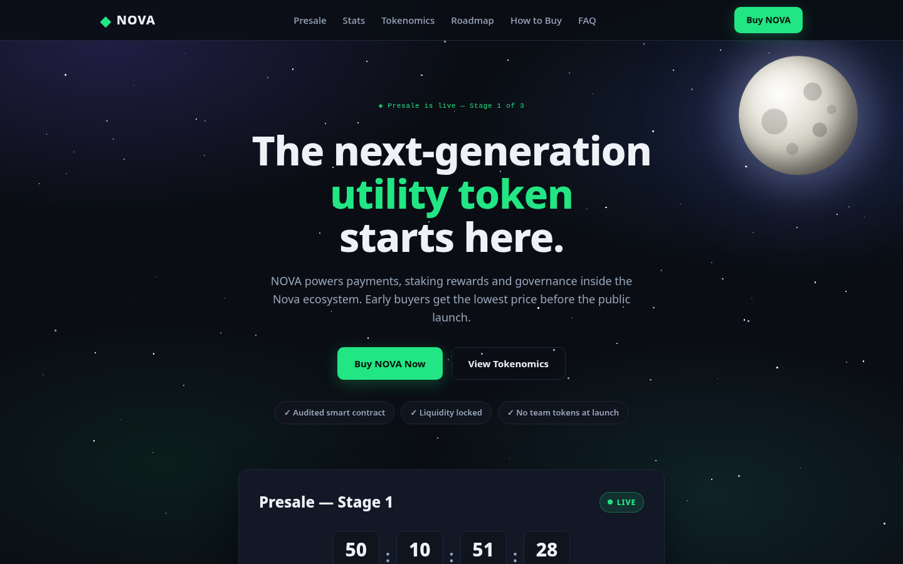
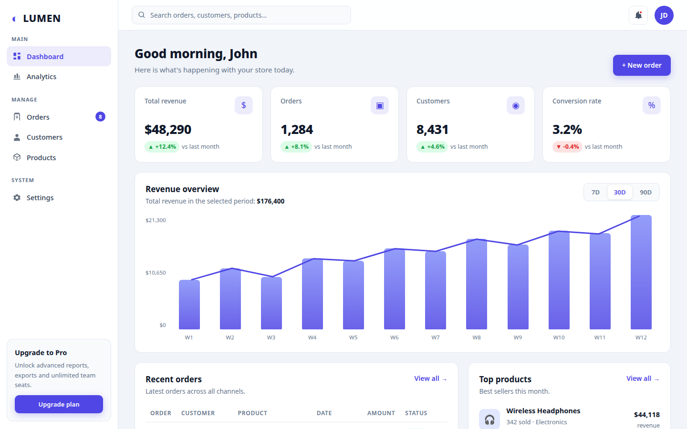
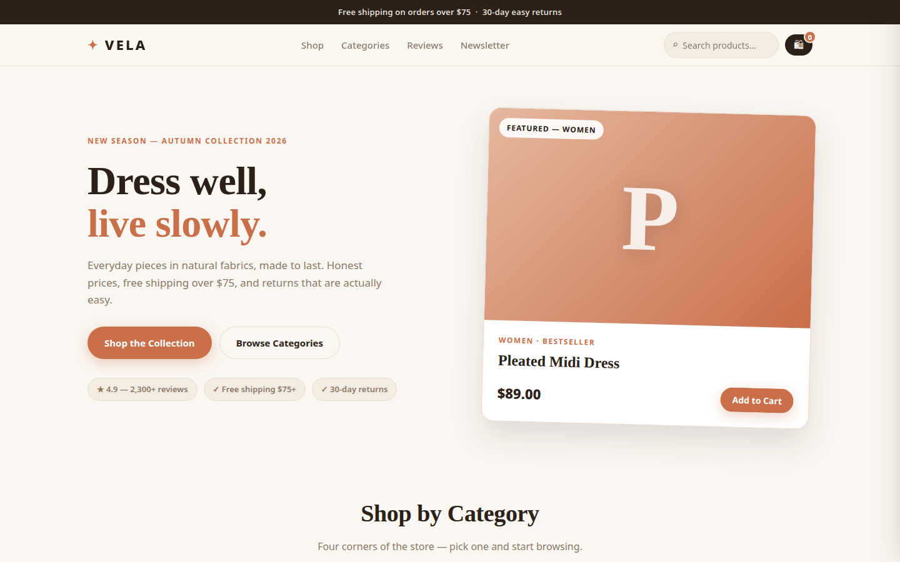
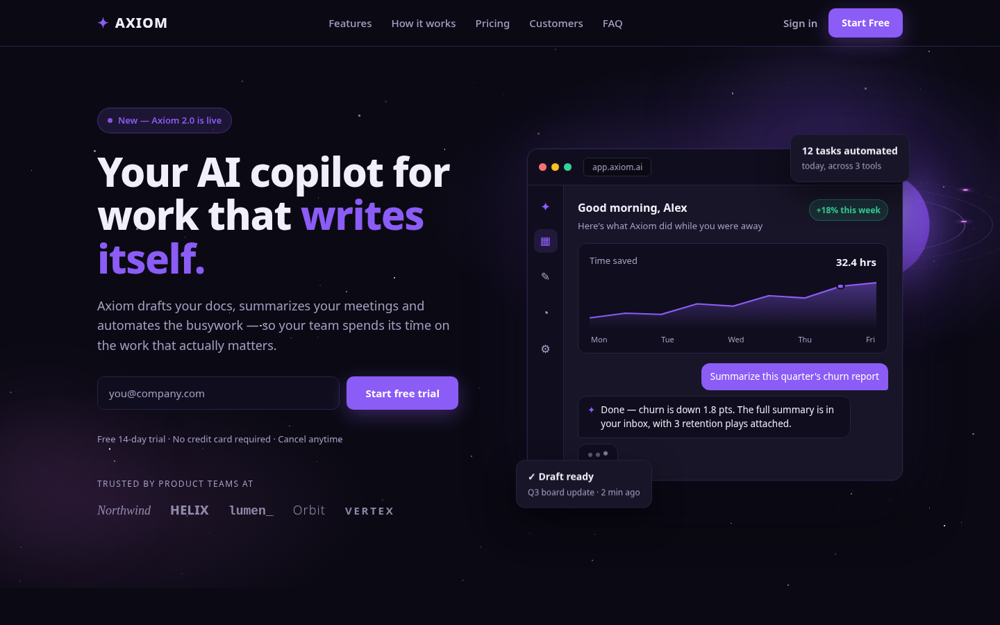
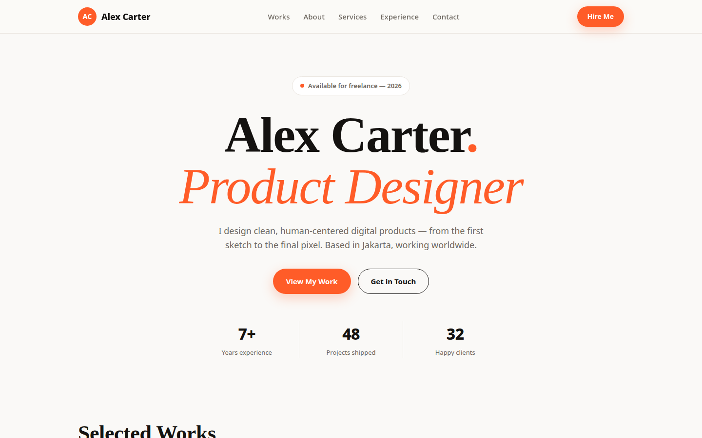

# NdysFortune Web Templates

Premium HTML website templates — pure HTML + CSS + vanilla JavaScript. No frameworks, no build step, no npm install. Unzip, edit one `CONFIG` block, upload anywhere (Netlify, Vercel, GitHub Pages, or any static host).

## Templates

| Template | Type | Price |
|---|---|---|
| [NOVA — Crypto Presale Landing](#nova--crypto-presale-landing-page--29) | Landing page | $29 |
| [LUMEN — Admin Dashboard](#lumen--admin-dashboard--39) | Dashboard / app UI | $39 |
| [VELA — E-commerce Storefront](#vela--e-commerce-storefront--39) | Online store | $39 |
| [AXIOM — AI SaaS Landing](#axiom--ai-saas-landing-page--29) | Landing page | $29 |
| [Alex Carter — Personal Portfolio](#alex-carter--personal-portfolio--19) | Portfolio | $19 |

---

### NOVA — Crypto Presale Landing Page — $29

Dark, modern landing page for a crypto token presale, ICO or IDO. Galaxy background with a pure-CSS 3D moon and twinkling stars. Live countdown timer, presale card with progress bar, token price / min / max buy, copy-to-clipboard contract address, animated stats row, tokenomics donut chart + allocation bars, roadmap timeline, 3-step How to Buy, FAQ accordion, sticky nav with mobile menu.

Details: [templates/nova-presale/](templates/nova-presale/)

### LUMEN — Admin Dashboard — $39

Clean light-theme admin dashboard. Sidebar navigation, topbar with live search, 4 stat cards with trends, revenue chart (CSS bars + SVG line) with 7D / 30D / 90D range switcher, recent orders table with status badges and search filter, top products list.

Details: [templates/lumen-dashboard/](templates/lumen-dashboard/)

### VELA — E-commerce Storefront — $39

Warm, elegant fashion/lifestyle storefront. Announcement bar, hero with featured product, category tiles, 8-product grid with filters and live search, working cart drawer (quantities, subtotal, free-shipping progress bar), testimonials, newsletter signup.

Details: [templates/vela-storefront/](templates/vela-storefront/)

### AXIOM — AI SaaS Landing Page — $29

Dark violet landing page for an AI / SaaS product. Web3 3D hero: glowing planet with 3 spinning orbit rings, twinkling stars, and a mouse-move 3D tilt on the app mockup — pure CSS + vanilla JS, no libraries. Left-aligned hero with email capture and a pure-CSS app mockup (chart, AI chat bubbles), features grid, 3-step how-it-works, pricing with monthly/yearly toggle, testimonials, FAQ accordion.

Details: [templates/axiom-saas/](templates/axiom-saas/)

### Alex Carter — Personal Portfolio — $19

Minimal portfolio for a designer or developer. Huge serif headline, selected works grid with category filters, about, services, experience timeline, testimonial, contact form with validation.

Details: [templates/alex-carter-portfolio/](templates/alex-carter-portfolio/)

---

## How to buy

Listings go live on **Creative Market** (shop application in progress). Each purchase includes the full template ZIP: `index.html`, `css/`, `js/`, `README.md` with the customization guide, and preview screenshots.

This repository is the storefront — it contains previews and descriptions only. **Full template source code is delivered with purchase, not from this repo.**

## Customization

Every template is customized from **one `CONFIG` object** at the top of `js/script.js` (names, prices, dates, stats, products, colors via CSS variables). No build tools needed — edit the config, save, refresh.

## License

All templates are commercial products by NdysFortune. See [LICENSE](LICENSE). Preview images and descriptions in this repo are for evaluation only — do not redistribute, resell, or give away any template files.

## Contact

Shop: NdysFortune — Creative Market (coming soon) · Gumroad: https://andymulya.gumroad.com
